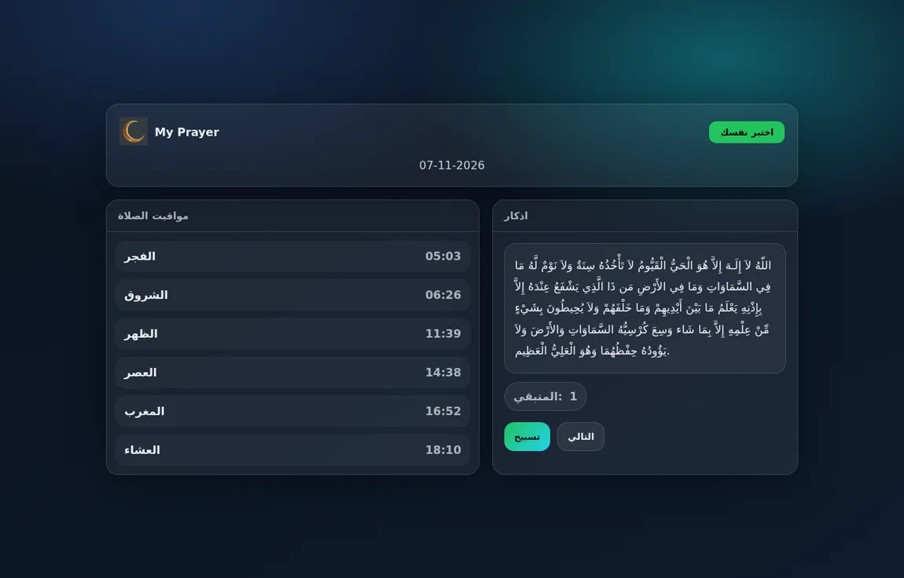

# Ramadan App

An Arabic React app with Cairo prayer times, a next-prayer indicator, an interactive Ramadan quiz, and an azkar reader with a repetition counter.

[Open the live demo](https://ramadan-ap.netlify.app/)



## Run locally

```bash
npm ci
npm start
```

Create React App serves the application at `http://localhost:3000`. Use `npm run build` to create a static production bundle.

- Prayer times are retrieved from the AlAdhan API for Cairo. This view needs an internet connection.
- Quiz questions and azkar are bundled as JSON in [`public/data/`](public/data/).
- Prayer-time notifications depend on browser support and user permission.

**Stack:** React, React Router, JavaScript, CSS, and SweetAlert2. The main routes and data loading are in [`src/components/App.js`](src/components/App.js).
